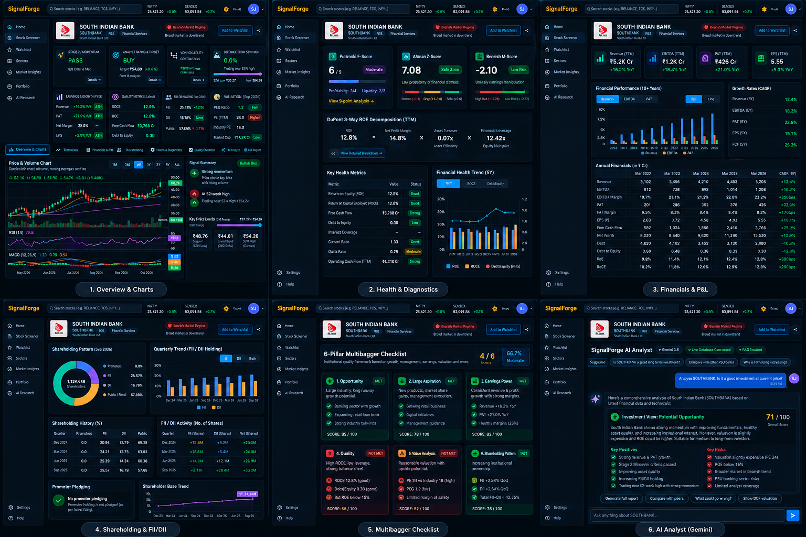

# SignalForge 🚀

**Evidence-First Equity Research, Quantitative Screening & Market Intelligence Platform for Indian Equities**

[](https://www.python.org/)
[](https://nextjs.org/)
[](https://fastapi.tiangolo.com/)
[](https://www.postgresql.org/)
[](https://redis.io/)
[](https://tailwindcss.com/)



SignalForge is a high-performance, evidence-driven market intelligence platform built specifically for Indian equities (NSE & BSE). It combines automated corporate earnings ingestion, institutional ownership tracking (Smart Money Flow), quantitative multi-factor scoring, technical momentum scans, and machine learning price forecasts into an intuitive research terminal.

---

## ✨ Key Features

### 1. 📊 Quant Screener & Multi-Factor Ranking
* **1,500+ Active Equities**: Instant client-side search, filtering, and sorting with sub-millisecond responsiveness.
* **Research Strength Score (0–100)**: Multi-component evidence synthesis combining Technical Structure, Price Momentum, Fundamental Health, Valuation Percentiles, Sector Relative Strength, Market Regime, and Risk Quality.
* **Smart Money Flow Tracking**: Real-time institutional holding indicators (FII QoQ/YoY shifts, DII flows, Promoter changes, and retail shareholder shakeout detection).
* **Technical & Momentum Flags**: Real-time TradingView technical momentum signals (`STRONG_BUY`, `BUY`, `NEUTRAL`, `SELL`, `STRONG_SELL`), 52-week high breakout proximity, and Volatility Contraction Pattern (VCP) indicators.

### 2. ⚡ High-Performance Parallel Earnings & Shareholding Sweep
* **Automated Parallel Ingestion**: Built with an asynchronous 5-worker queue consuming candidate equities with serialized rate-limit pacing (~2.5s per outbound request) to avoid IP blocks.
* **BSE Feed & Results Detection**: Auto-detects daily corporate earnings declarations from BSE XML feeds and Screener.in latest results feeds.
* **Bronze / Silver / Gold Storage**: Stores raw scrape HTML (Bronze), structured provider JSON (Silver), and normalized quarterly financial snapshots (Gold) spanning up to 14 quarters.

### 3. 🌐 Market Pulse & Regime Analysis
* **Market Regime Detection**: Classifies market conditions (e.g. `BEARISH_TREND`, `BULLISH_TREND`) based on Nifty 50 vs. 200 DMA, market breadth (% of stocks above 50/200 DMA), and rolling volatility.
* **Score Distribution Curve**: Interactive distribution spotlight displaying the entire universe across score bands (Very Weak, Weak, Neutral, Moderate, Strong).
* **Sector Performance Leaderboards**: Aggregated sector momentum and score rankings across 30+ industry sectors.

### 4. 🤖 AI Alpha Picks & ML Price Trajectory Forecasting
* **AI Alpha Picks**: LLM-curated conviction stock ideas generated using Google Gemini with structured thesis breakdowns.
* **ML Price Trajectories**: Deep learning price forecasts across 5-day, 10-day, and 20-day horizons with live directional accuracy (win rate %) and MAPE error tracking tiers.

### 5. 🔍 Stock Research Hub & Deep Diagnostic Cards
* **14-Quarter Earnings & P&L**: Full historical quarterly financial results with YoY growth calculations and EBITDA margin trajectories.
* **Ownership Breakdown**: 8-quarter FII, DII, Promoter, and Public shareholding progression charts.
* **Dynamic Bull & Bear Cases**: Automated evidence-backed bullish and bearish thesis generation for every active company.

---

## 🏛 Architecture

SignalForge is architected as a clean modular monorepo:

```
stock-analyst/
├── apps/
│   ├── api/            # FastAPI REST and streaming API (port 8000)
│   ├── web/            # Next.js 14 App Router, Tailwind CSS, TypeScript frontend (port 3000)
│   └── worker/         # Arq asynchronous background worker
├── packages/
│   ├── common/         # Database sessions, models, settings, Redis cache helpers
│   ├── fundamentals/   # Screener.in scraper, financial parser, shareholding sync
│   ├── scoring/        # 7-component evidence synthesis engine (Research Score v3)
│   ├── market_data/    # Daily OHLCV candles, TradingView technical momentum signals
│   ├── momentum/       # 52-week breakouts & Volatility Contraction Pattern (VCP) scanner
│   ├── analyst_estimates/ # Target prices, upside percentages, and analyst ratings
│   ├── ai/             # Vertex AI / Gemini integration, AI Alpha Picks generator
│   └── kronos/         # Deep learning price trajectory forecast models
├── migrations/         # Alembic database migrations
├── scripts/            # CLI utilities (parallel sweeps, backfills, diagnostics)
└── infra/              # Docker Compose and container configs
```

---

## 🚀 1-Command Startup (Docker)

### Prerequisites
* [Docker](https://docs.docker.com/get-docker/) & Docker Compose (v2.20+) installed.

### Launching the Entire Platform

```bash
# 1. Clone the repository
git clone https://github.com/sandeepj15/stock-analyst.git
cd stock-analyst

# 2. Copy the environment template
cp .env.example .env

# 3. Start all services in 1 command
./start.sh
```

*(Alternatively, run `docker compose up --build -d`)*

### What happens automatically on first boot:
1. Provisions **PostgreSQL 16** and **Redis 7** with automated health checks.
2. Applies database migrations (`alembic upgrade head`).
3. Seeds initial equity universe and precomputes initial market regime and scoring benchmarks.
4. Starts the **FastAPI** backend and **Arq** background worker.
5. Boots the **Next.js 14** web application.

### Access URLs:
* **Web Research Terminal**: [http://localhost:3000](http://localhost:3000)
* **Interactive API Documentation (Swagger)**: [http://localhost:8000/docs](http://localhost:8000/docs)
* **Backend Health Check**: [http://localhost:8000/health/db](http://localhost:8000/health/db)

---

## 🛠 Running the Sweeps & Ingestion Pipelines

### Screener.in 5-Worker Parallel Sweep
To scan candidate equities, ingest newly reported Q2 earnings, and update September 2026 shareholding patterns:

```bash
docker compose exec -T api python /app/parallel_screener_sweep.py --workers 5
```

### Daily Market Close Ingestion
To fetch daily OHLCV prices and compute technical indicators:

```bash
docker compose exec api python scripts/seed_dev_data.py
```

### Recompute Universe Research Scores
```bash
docker compose exec api python -c "
import asyncio
from packages.common.db import session_scope
from packages.scoring.engine import recompute_universe_scores
asyncio.run(recompute_universe_scores())
"
```

---

## 💻 Local Development Workflow (Without Docker)

If developing locally with hot-reloading:

```bash
# 1. Start database and cache services
docker compose up -d postgres redis

# 2. Run backend API
python3 -m venv .venv
source .venv/bin/activate
pip install -r requirements.txt
alembic upgrade head
uvicorn apps.api.main:app --host 0.0.0.0 --port 8000 --reload

# 3. Run frontend
cd apps/web
pnpm install
pnpm dev
```

---

## 🤝 Contributing

We welcome contributions! Please review our **[CONTRIBUTING.md](./CONTRIBUTING.md)** guide for:
* Step-by-step development setup and environment configuration.
* Coding standards (Python Ruff/Mypy & Next.js/TypeScript).
* Creating database migrations with Alembic.
* Pull Request submission workflow.

---

## 📄 License

This project is licensed under the MIT License. See [LICENSE](LICENSE) for details.
